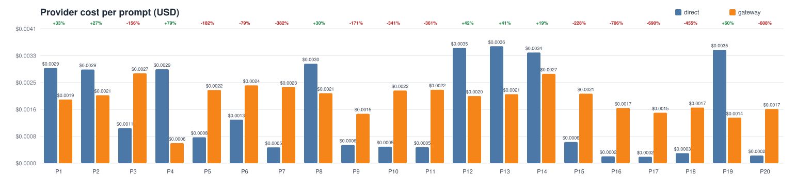

# Результаты тестирования tokenmaxing

Замеры ниже сделаны в **discovery**-режиме (с прогрессивным поиском); гибридный
passthrough для маленьких каталогов появился позже и на эти цифры не влияет.

Коротко: стартовый контекст определений тулов — до **−95.4%** (19 416 → 901),
сжатие Headroom — **−49%** на JSON/логах. По реальным токенам провайдера всё
зависит от **кэша определений**: на холодном старте шлюз дешевле; в историческом
20-промптовом прогоне direct выигрывал на прогретом кэше, но после adaptive `auto`
и кеша финальный A/B показывает discovery дешевле direct по cost (−18.3%).
Ниже — оба снимка.

После появления гибридного режима и дешёвого discovery (раздел 6): `passthrough`
на маленьких каталогах работает как direct и примерно вдвое дешевле discovery;
ответ `search_tools` для широких запросов стал в 4.9 раза дешевле, а типовой
discovery-флоу — на 44.7% дешевле. После adaptive `auto`, компактных мета-схем и кеша
использованных тулов: 7 мета-тулов **1 409 → 901** токен, узкие запросы discovery
дешевле на 37–63%, частые тулы подсказываются в instructions. В финальном A/B
(6.6) discovery уже **дешевле direct по cost (−18.3%) и input (−31.9%)**, хотя total
на 9.3% выше из-за cache read; passthrough — лучший по total и cost. Это один прогон,
вывод хрупкий.

Стенд: macOS arm64, Rust 1.100, `opencode` + модель `opencode-go/deepseek-v4.1-flash`,
25 ноября 2026. Все цифры — один прогон, без статистической значимости.

## 1. Контекст определений тулов (реальный токенайзер)

Считаем реальным токенайзером tiktoken: `o200k_base` по умолчанию
(`TOKENMAXING_TOKENIZER` = `o200k_base` / `cl100k_base` / `p50k_base` / `r50k_base`).
Это не `символы / 4`. Baseline — все определения тулов, как их получил бы клиент
без шлюза. Gateway — 7 мета-тулов, которые видны модели в discovery-режиме.

| Сценарий | Тулов | tokens (tiktoken) |
|---|---:|---:|
| direct: 4 сервера | 42 | 19 416 |
| gateway: мета-тулы (после компактных схем, 6.5) | 7 | **901** |
| gateway + инспекция 2 тулов | — | 3 154 |
| **экономия после инспекции** | — | **83.8%** |
| direct + DeepWiki включён | 47 | 19 815 |
| **экономия на старте (47 тулов)** | — | **95.5%** |

Исторический замер до сжатия мета-схем: 1 367 токенов (81.4% после инспекции,
93.1% на старте с DeepWiki).

Вывод: чем больше каталог, тем сильнее выигрыш. Даже после загрузки пары схем
шлюз остаётся кратно дешевле прямого подключения.

## 2. Реальный A/B на промптах (токены провайдера)

Бенчмарк запускал `opencode run --format json` на одних и тех же
промптах дважды: с прямым подключением всех серверов и через `tokenmaxing`. Берутся
реальные токены из событий `step_finish` (total/input/output/cache/cost). Скрипт
бенчмарка не входит в минимальный репозиторий; артефакты ниже.

Последний снимок — **20 промптов**: filesystem (6), memory (5),
sequential-thinking (4), everything (5). Полная таблица по каждому промпту:
`results/ab_tokens_table.md`.

| | direct | gateway | разница |
|---|---:|---:|---:|
| input (некэшированные) | 169 513 | 175 270 | gateway **+3.4%** |
| cost | $0.03235 | $0.03932 | gateway **+21.5%** |
| total (с cache read) | 1 228 334 | 1 220 324 | gateway **−0.7%** |

Главный эффект — **кэш определений тулов у провайдера**:

- Первый промпт (кэш холодный): input **18 525 → 9 432 (−49.1%)**,
  cost **$0.00290 → $0.00194 (−33.1%)** — шлюз дешевле.
- Дальше direct получает большие cache-hit'ы: на простых промптах его
  некэшированный input падает до 269–1 275 токенов, потому что 47 определений
  тулов уже в кэше. Шлюз каждый раз платит за discovery (~8–10k input), хотя
  его мета-тулы тоже кэшируются.
- Поэтому на длинной серии простых задач direct может оказаться дешевле, а на
  холодном старте, большом/меняющемся каталоге и крупных результатах — шлюз.

Предыдущий 3-промптовый прогон (кэш холоднее): input **−61.7%**, cost **−45.6%**.
Разброс между прогонами большой; это ожидаемо из-за кэширования.

### Графики




Сырые данные снимка: `results/ab_tokens.json` (`generated_at`, `model`, все прогоны).

## 3. Сжатие результатов через Headroom

Проверяли реальный Headroom 0.45.0 (`uvx --python 3.12 --from "headroom-ai[mcp]"`).
Headroom возвращает собственные счётчики токенов.

| Payload | До | После | Сэкономлено | Трансформация |
|---|---:|---:|---:|---|
| JSON-логи, 300 записей | 17 708 | 9 031 | 8 677 (**49.0%**) | `router:smart_crusher` |
| grep-строки, 400 строк | 7 986 | 6 394 | 1 592 (**19.9%**) | `router:search` |
| обычный текст (prose) | 2 209 | 2 209 | 0 (**0%**) | `router:noop` |

E2E-прогон (файл `logs.json`, 400 записей):

- 23 608 → 12 031 токенов (**49.0%**), hash выдан;
- `headroom_retrieve` вернул исходные **58 858 символов** байт-в-байт;
- метрика `tokenmaxing_compression_saved_tokens_total` выросла на 11 577;
- `headroom_compress` скрыт из каталога, `headroom_retrieve` доступен.

Вывод: Headroom выигрывает на **структурированных и повторяющихся данных**
(JSON, логи, результаты поиска) и бесполезен на обычном тексте. Это ожидаемо.


Сырые данные: `results/headroom.json`.

## 4. Внешний MCP и агенты

- **Remote MCP (DeepWiki)** подключается и работает:
  3 тула, реальный вызов `read_wiki_structure` вернул структуру репозитория.
  По пути был исправлен баг: не был включён TLS-бэкенд `reqwest`.
- **20 агентов** (10 Claude + 10 opencode) созданы как конфиги; opencode
  подтвердил обнаружение (`tokenmaxing-researcher` распознан как subagent). Нагрузочный
  A/B именно агентами не прогонялся — цифры выше не включают агентные сессии.

## 5. Где выигрываем и где нет

**Выигрываем:**
- Большой каталог тулов/серверов: стартовый контекст **−95.4%** (19 416 → 901).
- Холодный старт: первый промпт input −49.1%, cost −33.1%; 3-промптовый
  прогон при более холодном кэше: input −61.7%, cost −45.6%.
- Adaptive `auto` на узких запросах: −37…−63% токенов discovery и −1 вызов.
- Финальный A/B после adaptive/cache: discovery дешевле direct по cost **−18.3%**
  и input **−31.9%**; passthrough — **−22.8%** cost и **−34.8%** total.
- Крупные структурированные результаты: сжатие до −49%.
- Многошаговые задачи, где discovery окупается.

**Не выигрываем / нейтрально:**
- Длинная серия простых промптов с прогретым кэшем: в историческом 20-промптовом
  прогоне (до adaptive/cache) input **+3.4%**, cost **+21.5%**. После adaptive `auto`
  и кеша — discovery дешевле по cost/input, но `total` +9.3% из-за cache read.
  Это один прогон, вывод хрупкий.
- `total` с cache read шумный: в 20-промптовом прогоне gateway на 0.7% меньше,
  но это не устойчивый вывод.
- Обычный текст: Headroom часто `noop` (0%).
- Латентность: не измеряли отдельно; discovery добавляет round-trips.
- Маленький каталог: discovery для него дороже; auto-passthrough (≤20 тулов)
  работает как direct.

**Рекомендация:** оставить `auto`: маленькие каталоги → passthrough, большие →
discovery; включать шлюз при десятках/сотнях тулов, нескольких upstream, больших
выводах и ограничениях по контексту/стоимости.

## 6. Гибридный режим и дешёвый discovery (2026-11-26)

Замеры после изменений: `auto`/`passthrough` и удешевлённый discovery
(`name` по умолчанию, `summary` в одну строку, `schema`, batch `get_tool_details`).

### 6.1 Стартовые определения и уровни detail (без LLM)

Стенд: 4 локальных npx-сервера (filesystem, memory, sequential-thinking, everything),
**42 тула**, tiktoken `o200k_base`.

| | прямые определения | gateway discovery |
|---|---:|---:|
| tokens (после компактных схем, 6.5) | 19 416 | **901** |
| экономия | — | **95.4%** |

Исторический замер до сжатия мета-схем: 1 409 токенов (92.7%); см. 6.5.

`search_tools` на 10 запросах (в среднем 6 тулов в ответе):

| detail | среднее токенов | против `name` | против `full` |
|---|---:|---:|---:|
| `name` | 70.3 | — | — |
| `summary` | 346.5 | +393% | — |
| `schema` | 636.4 | +805% | −48.5% |
| `full` | 1 236.6 | +1 659% | — |

Типовой discovery-флоу (`search_tools` → `get_tool_details` первого кандидата):

| флоу | вызовов | среднее токенов | против старого |
|---|---:|---:|---:|
| старый: `summary` + details | 2 | 617.4 | — |
| новый: `name` + details | 2 | **341.2** | **−44.7%** |
| только `schema`, без details | 1 | 636.4 | +3.1% |

`get_tool_details` batch на 5 тулах: **1 538** токенов за 1 вызов против **1 535**
за 5 вызовов. Экономии токенов нет (−3, шум); выигрыш только в round-trips: 1 вместо 5.

### 6.2 Маленький каталог: auto-passthrough (без LLM)

| Конфиг | auto-режим | `tools/list` | определения, tokens |
|---|---|---|---:|
| demo, 2 тула | passthrough | `echo`, `ping` | 83 |
| demo, 2 тула | discovery | 7 мета-тулов | 901 |

Passthrough убирает 818 токенов стартовых определений (90.8% от 901) и не платит
за discovery.

### 6.3 LLM A/B до adaptive auto и кеша: filesystem, 16 тулов, 5 промптов

`opencode run --format json`, модель `opencode-go/deepseek-v4.1-flash`, прогретый
провайдерский кэш; один прогон на промпт в каждом режиме.

| | total | input | cache read | cost |
|---|---:|---:|---:|---:|
| direct | 241 842 | 53 635 | 186 112 | $0.00986 |
| discovery | 387 064 | 51 064 | 331 136 | $0.01157 |
| passthrough (отдельный парный прогон) | 186 637 | 41 123 | 144 384 | $0.00728 |
| direct в том же парном прогоне | 229 541 | 53 619 | 174 080 | $0.00967 |

- discovery против direct: total **+60.0%**, cost **+17.4%**, input **−4.8%**,
  cache read **+77.9%**. Модель делает больше discovery-вызовов (2–10 против 1–6).
- passthrough против direct в парном прогоне: total **−18.7%**, cost **−24.7%**,
  input **−23.3%** — но это в пределах шума и различий в поведении модели, не
  устойчивый выигрыш. Главное: passthrough радикально дешевле discovery.
- В одном direct-прогоне модель вызвала `grep` вместо MCP-тула, несмотря на
  инструкцию; это искажает сравнение.
- Первый холодный парный прогон (тот же filesystem, до прогрева кэша):
  direct **$0.00207** / input 11 163, gateway **$0.00188** / input 8 989 —
  gateway дешевле на 8.8% по cost и 19.5% по input (один промпт, ориентир).

Этот срез сделан **до** adaptive `auto` и кеша; актуальные цифры — в 6.6.

### 6.4 LLM A/B до adaptive auto и кеша: memory, 9 тулов, 3 промпта — auto против discovery

| режим | total | input | cache read | cost |
|---|---:|---:|---:|---:|
| direct | 104 571 | 24 377 | 79 744 | $0.00417 |
| auto (passthrough) | 102 716 | 26 070 | 76 032 | $0.00451 |
| discovery | 213 926 | 29 915 | 181 888 | $0.00631 |

Auto-passthrough против direct: total **−1.8%**, cost **+8.2%** — практически паритет.
Discovery против direct: total **+104.6%**, cost **+51.3%**. Auto-passthrough против
discovery: total **−52.0%**, cost **−28.5%**.

Этот срез сделан **до** adaptive `auto` и кеша; актуальные цифры — в 6.6.

### 6.5 Adaptive auto, компактные мета-схемы и кеш (без LLM)

Определения 7 мета-тулов теперь отдаются с компактными схемами (без `$schema`,
описаний и примеров):

| | tokens |
|---|---:|
| до | 1 409 |
| после | **901** (−36.1%) |
| стартовая экономия против direct (19 416) | **95.4%** |

`search_tools` по умолчанию `auto`: 1–3 совпадения → компактная схема, иначе имена.
Замеры на тех же 4 серверах и 42 тулах:

| запрос | совпадений | `auto` | `name` + `get_tool_details` | экономия |
|---|---:|---:|---:|---:|
| `echo` | 1 | 56 | 89 | **−37.1%** |
| `thinking` | 1 | 233 | 628 | **−62.9%** |
| `file` | 10 | 107 | — | `auto` = `name` |

На узких запросах `auto` экономит один round-trip и 37–63% токенов discovery;
на широких ведёт себя как `name`.

Кеш использованных тулов проверен детерминированно:

- записывается из `call_tool`, passthrough и `callTool` внутри `execute_code`;
- после перезапуска в instructions появляется `Frequently used tools`;
- для тула ленивого сервера подсказка содержит `(enable server 'demo')`;
- ранжирование `search_tools` учитывает счётчики (unit-тест);
- хранятся только имя, сервер, счётчик, `last_used` и однострочное описание.

### 6.6 Финальный LLM A/B после adaptive auto и кеша

Тот же filesystem-каталог (16 тулов) и те же 5 промптов, но уже с adaptive `auto`,
компактными мета-схемами и (в одном варианте) предзаполненным кешем использованных
тулов. Прогретый кэш провайдера, один прогон на промпт.

| режим | total | input | cache read | cost | Δcost vs direct |
|---|---:|---:|---:|---:|---:|
| direct | 286 734 | 64 019 | 220 672 | $0.01149 | — |
| discovery | 313 397 | 43 608 | 266 368 | $0.00939 | **−18.3%** |
| discovery + cache | 304 641 | 42 970 | 258 304 | $0.00924 | **−19.6%** |
| passthrough | 186 875 | 50 805 | 134 656 | $0.00887 | **−22.8%** |

- discovery против direct: input **−31.9%**, cost **−18.3%**, но total **+9.3%**
  из-за cache read. Модель делает 5–8 вызовов против 2–6 у direct.
- Кеш даёт небольшой дополнительный эффект: против discovery total **−2.8%**,
  cost **−1.6%** (в пределах шума).
- passthrough — лучший по total (**−34.8%** к direct) и cost (**−22.8%**);
  в этом прогоне модель сделала 2–3 вызова на промпт.
- В одном passthrough-прогоне модель всё же вызвала `grep` вместо MCP-тула.

Этот прогон меняет вывод из 6.3: после adaptive `auto` и кеша discovery на простых
задачах **дешевле direct по cost/input**, хотя total чуть выше. Один прогон и
5 промптов — вывод хрупкий; кэш провайдера и поведение модели доминируют.

### 6.7 Выводы

- Дешёвый discovery работает на уровне payload: для широких запросов `name`/`auto`
  в 4.9 раза дешевле старого `summary`, типовой флоу — на 44.7% дешевле,
  `schema` вдвое дешевле `full`.
- Adaptive `auto` убирает второй вызов на узких запросах: −37…−63% токенов discovery.
- Компактные мета-схемы уменьшили префикс с 1 409 до 901 токена (−36.1%), стартовая
  экономия против direct — 95.4%.
- Кеш использованных тулов ранжирует поиск и добавляет частые тулы в instructions;
  в финальном A/B вариант с кешем немного дешевле discovery без кеша.
- До adaptive/cache discovery на прогретом кэше проигрывал (6.3: **+17.4% cost**).
  После изменений — выигрывает по cost/input (6.6: **−18.3% cost**, −31.9% input),
  но total выше на 9.3% из-за cache read. Это один прогон, вывод хрупкий.
- Гибридный режим работает: на 9- и 16-туловых каталогах passthrough ≈ direct и
  дешевле discovery; в финальном A/B passthrough — лучший по total и cost.
- **Порог поднят с 15 до 20:** 16-туловый filesystem в auto теперь выбирает
  passthrough (проверено E2E); отдельного LLM-прогона именно auto нет.
- Batch `get_tool_details` не экономит токены, только round-trips.
- Ограничения: один прогон, без статистической значимости; кэш провайдера доминирует;
  промптов мало (5), а поведение модели между прогонами различается.

## 7. Артефакты

Скрипты бенчмарка и мониторинга в минимальный репозиторий не входят; ниже —
зафиксированные результаты. Сырые артефакты в `results/` (кроме нового снимка)
записаны до переименования в tokenmaxing; исторические пути и имена метрик внутри
JSON не переписывались.

Собрать и проверить Rust-код:

```bash
cargo build --release --locked
cargo test
cargo clippy --all-targets
```

Артефакты снимка: `results/ab_tokens.json`, `results/ab_tokens_table.md`,
`results/headroom.json`, `results/ab_tokens_input.svg`, `results/ab_tokens_cost.svg`,
`results/headroom.svg`.

Новый снимок (раздел 6): `results/modes_2026-11-26.json` — стартовые определения,
уровни `detail`, batch, auto-passthrough и сырые прогоны LLM A/B.
Follow-up (adaptive `auto`, компактные мета-схемы, кеш):
`results/adaptive_cache_2026-11-26.json`.
Финальный 4-way A/B после adaptive/cache:
`results/final_ab_2026-11-26.json` (direct / discovery / discovery+cache / passthrough).

Токены в метриках считает реальный токенайзер tiktoken (`TOKENMAXING_TOKENIZER`,
по умолчанию `o200k_base`), а не `символы / 4`. Для конкретной модели провайдера
точные цифры даёт A/B-бенчмарк (см. выше).

## 8. Проверки

Финальный прогон: `cargo fmt --check`, `cargo clippy --all-targets -- -D warnings`,
`cargo test` (**25 passed**), `cargo build --release --locked` — без ошибок.
E2E: **102 проверки основного цикла + 33 проверки кеша результатов тулов = 135,
0 падений, 0 пропусков**.

| Область | Проверок |
|---|---:|
| Discovery API, уровни detail, ошибки, execute_code, lifecycle | 29 |
| Adaptive `auto` и компактные схемы | 8 |
| Режимы auto/discovery/passthrough, пороги, invalid env | 9 |
| Кеш использованных тулов | 7 |
| Headroom: сжатие, retrieve, fail-open, метрики | 11 |
| Конфиг: невалидные записи, missing/malformed, compression | 5 |
| Коллизии имён | 9 |
| Prometheus-метрики | 14 |
| `notifications/tools/list_changed` | 5 |
| HTTP upstream (DeepWiki) | 2 |
| opencode LLM smoke | 3 |
| **Кеш результатов тулов** (exact/semantic, persistence, allowlist, off, code mode, compression, OpenAI/Ollama mock) | **33** |

Кеш результатов тулов сокращает **upstream-вызовы** (в E2E 2 → 1 на повторный запрос),
но не токены контекста: возвращается тот же результат. End-to-end LLM A/B для него
не прогонялся.

E2E-раннер, синтетический upstream и mock-сервер эмбеддингов в минимальный
репозиторий не входят, чтобы не раздувать поставку; цифры выше — результат
локального прогона. Сводка: `results/tool_cache_2026-11-26.json`.
