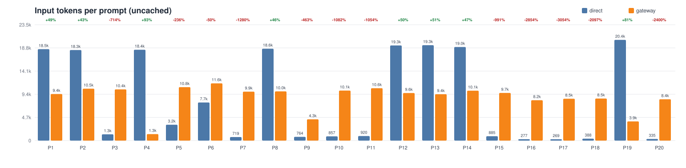
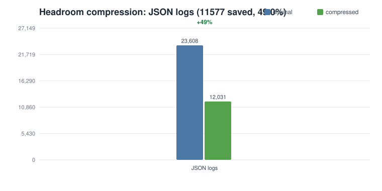

# Результаты тестирования tokenmaxing

Коротко: стартовый контекст определений тулов **−93%**, сжатие Headroom **−49%**
на JSON/логах. По реальным токенам провайдера всё зависит от **кэша определений**:
на холодном старте шлюз дешевле, на длинной серии простых промптов с прогретым
кэшем direct может быть дешевле. Ниже — оба снимка.

Стенд: macOS arm64, Rust 1.100, `opencode` + модель `opencode-go/deepseek-v4.1-flash`,
25 ноября 2026. Все цифры — один прогон, без статистической значимости.

## 1. Контекст определений тулов (реальный токенайзер)

Считаем реальным токенайзером tiktoken: `o200k_base` по умолчанию
(`TOKENMAXING_TOKENIZER` = `o200k_base` / `cl100k_base` / `p50k_base` / `r50k_base`).
Это не `символы / 4`. Baseline — все определения тулов, как их получил бы клиент
без шлюза. Gateway — 7 мета-тулов, которые всегда видны модели.

| Сценарий | Тулов | tokens (tiktoken) |
|---|---:|---:|
| direct: 4 сервера | 42 | 19 416 |
| gateway: мета-тулы | 7 | 1 367 |
| gateway + инспекция 2 тулов | — | 3 620 |
| **экономия после инспекции** | — | **81.4%** |
| direct + DeepWiki включён | 47 | 19 815 |
| **экономия на старте (47 тулов)** | — | **93.1%** |

Вывод: чем больше каталог, тем сильнее выигрыш. Даже после загрузки пары схем
шлюз остаётся кратно дешевле прямого подключения.

## 2. Реальный A/B на промптах (токены провайдера)

Бенчмарк запускал `opencode run --format json` на одних и тех же
промптах дважды: с прямым подключением всех серверов и через `tokenmaxing`. Берутся
реальные токены из событий `step_finish` (total/input/output/cache/cost). Скрипт
бенчмарка не входит в минимальный репозиторий; артефакты ниже.

Последний снимок — **20 промптов**: filesystem (6), memory (5),
sequential-thinking (4), everything (5). Полная таблица по каждому промпту:
`results/ab_tokens_table.md`.

| | direct | gateway | разница |
|---|---:|---:|---:|
| input (некэшированные) | 169 513 | 175 270 | gateway **+3.4%** |
| cost | $0.03235 | $0.03932 | gateway **+21.5%** |
| total (с cache read) | 1 228 334 | 1 220 324 | gateway **−0.7%** |

Главный эффект — **кэш определений тулов у провайдера**:

- Первый промпт (кэш холодный): input **18 525 → 9 432 (−49.1%)**,
  cost **$0.00290 → $0.00194 (−33.1%)** — шлюз дешевле.
- Дальше direct получает большие cache-hit'ы: на простых промптах его
  некэшированный input падает до 269–1 275 токенов, потому что 47 определений
  тулов уже в кэше. Шлюз каждый раз платит за discovery (~8–10k input), хотя
  его мета-тулы тоже кэшируются.
- Поэтому на длинной серии простых задач direct может оказаться дешевле, а на
  холодном старте, большом/меняющемся каталоге и крупных результатах — шлюз.

Предыдущий 3-промптовый прогон (кэш холоднее): input **−61.7%**, cost **−45.6%**.
Разброс между прогонами большой; это ожидаемо из-за кэширования.

### Графики




Сырые данные снимка: `results/ab_tokens.json` (`generated_at`, `model`, все прогоны).

## 3. Сжатие результатов через Headroom

Проверяли реальный Headroom 0.45.0 (`uvx --python 3.12 --from "headroom-ai[mcp]"`).
Headroom возвращает собственные счётчики токенов.

| Payload | До | После | Сэкономлено | Трансформация |
|---|---:|---:|---:|---|
| JSON-логи, 300 записей | 17 708 | 9 031 | 8 677 (**49.0%**) | `router:smart_crusher` |
| grep-строки, 400 строк | 7 986 | 6 394 | 1 592 (**19.9%**) | `router:search` |
| обычный текст (prose) | 2 209 | 2 209 | 0 (**0%**) | `router:noop` |

E2E-прогон (файл `logs.json`, 400 записей):

- 23 608 → 12 031 токенов (**49.0%**), hash выдан;
- `headroom_retrieve` вернул исходные **58 858 символов** байт-в-байт;
- метрика `tokenmaxing_compression_saved_tokens_total` выросла на 11 577;
- `headroom_compress` скрыт из каталога, `headroom_retrieve` доступен.

Вывод: Headroom выигрывает на **структурированных и повторяющихся данных**
(JSON, логи, результаты поиска) и бесполезен на обычном тексте. Это ожидаемо.



Сырые данные: `results/headroom.json`.

## 4. Внешний MCP и агенты

- **Remote MCP (DeepWiki)** подключается и работает:
  3 тула, реальный вызов `read_wiki_structure` вернул структуру репозитория.
  По пути был исправлен баг: не был включён TLS-бэкенд `reqwest`.
- **20 агентов** (10 Claude + 10 opencode) созданы как конфиги; opencode
  подтвердил обнаружение (`tokenmaxing-researcher` распознан как subagent). Нагрузочный
  A/B именно агентами не прогонялся — цифры выше не включают агентные сессии.

## 5. Где выигрываем и где нет

**Выигрываем:**
- Большой каталог тулов/серверов: стартовый контекст −93%.
- Холодный старт: первый промпт input −49.1%, cost −33.1%; 3-промптовый
  прогон при более холодном кэше: input −61.7%, cost −45.6%.
- Крупные структурированные результаты: сжатие до −49%.
- Многошаговые задачи, где discovery окупается.

**Не выигрываем / нейтрально:**
- Длинная серия простых промптов с прогретым кэшем определений: в 20-промптовом
  прогоне input у шлюза **+3.4%**, cost **+21.5%**; direct получает cache-hit'ы
  на свои 47 тулов, а шлюз платит за discovery на каждом запросе.
- `total` с cache read шумный: в 20-промптовом прогоне gateway на 0.7% меньше,
  но это не устойчивый вывод.
- Обычный текст: Headroom часто `noop` (0%).
- Латентность: не измеряли отдельно; поиск/инспекция добавляют round-trips.
- Маленький каталог (единицы тулов): прямое подключение может быть проще и дешевле.

**Рекомендация:** включать шлюз при десятках/сотнях тулов, нескольких upstream,
больших выводах и ограничениях по контексту/стоимости. Для одного простого вызова
без большого каталога прямой режим может быть выгоднее.

## 6. Артефакты

Скрипты бенчмарка и мониторинга в минимальный репозиторий не входят; ниже —
зафиксированные результаты. Сырые артефакты в `results/` записаны до переименования
в tokenmaxing; исторические пути и имена метрик внутри JSON не переписывались.

Собрать и проверить Rust-код:

```bash
cargo build --release --locked
cargo test
cargo clippy --all-targets
```

Артефакты снимка: `results/ab_tokens.json`, `results/ab_tokens_table.md`,
`results/headroom.json`, `results/ab_tokens_input.svg`, `results/ab_tokens_cost.svg`,
`results/headroom.svg`.

Токены в метриках считает реальный токенайзер tiktoken (`TOKENMAXING_TOKENIZER`,
по умолчанию `o200k_base`), а не `символы / 4`. Для конкретной модели провайдера
точные цифры даёт A/B-бенчмарк (см. выше).
